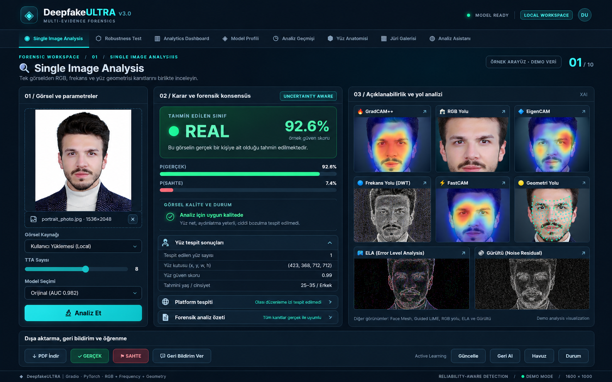
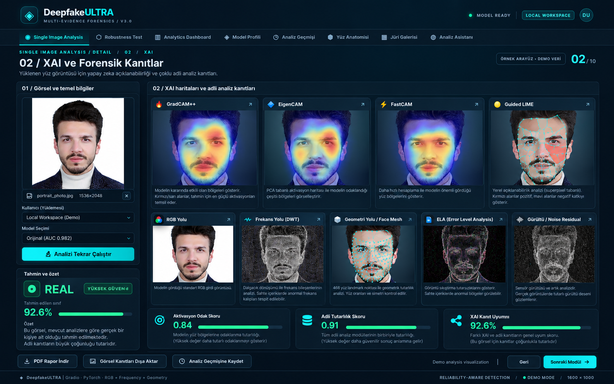
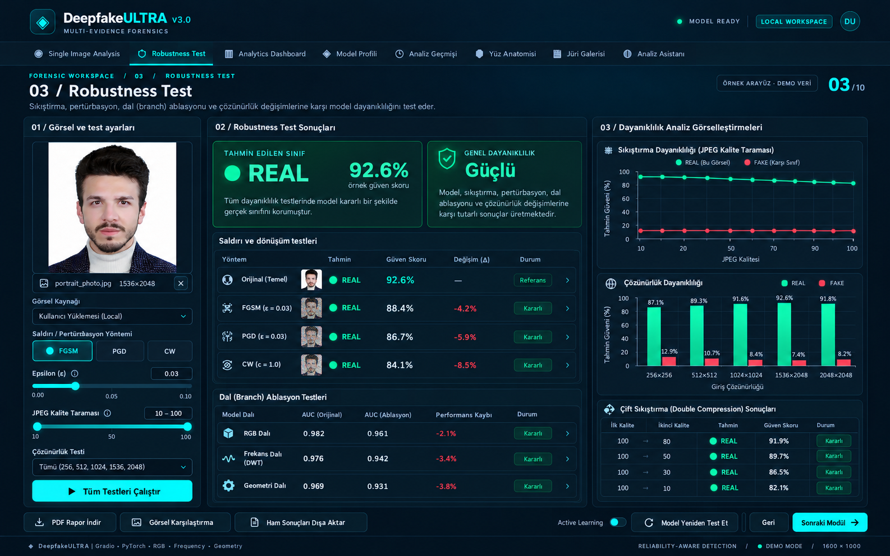
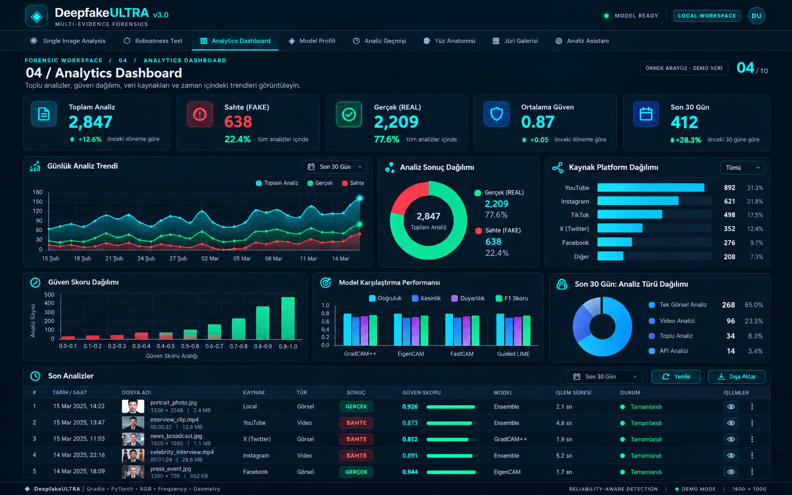
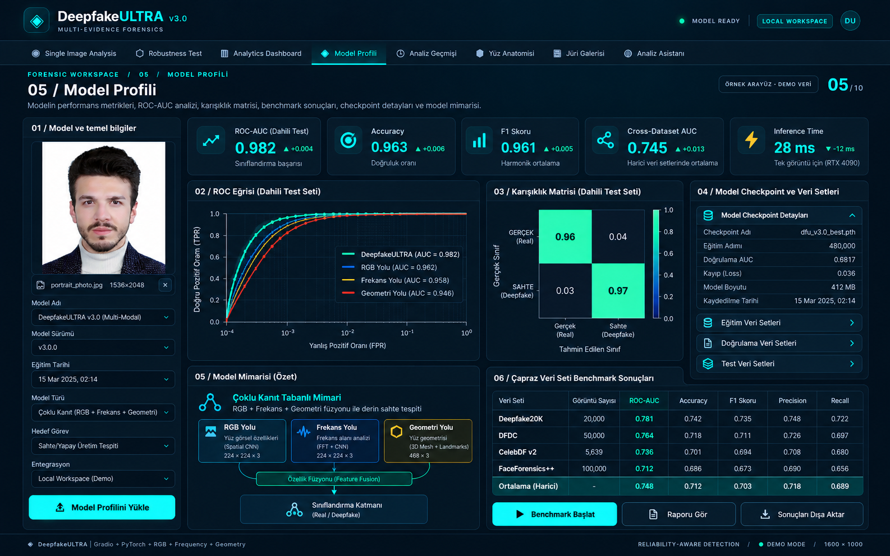
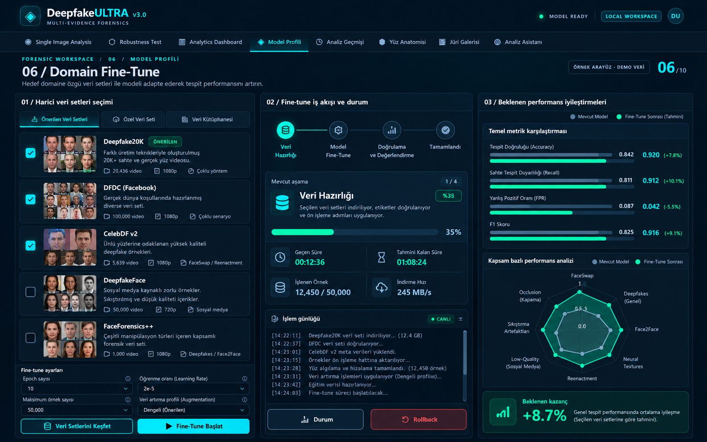
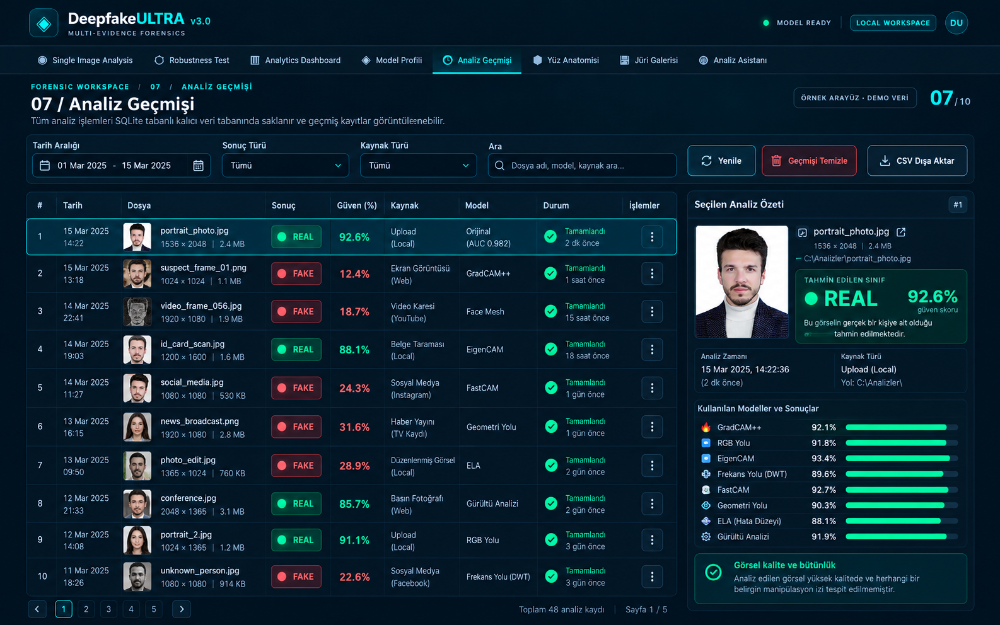
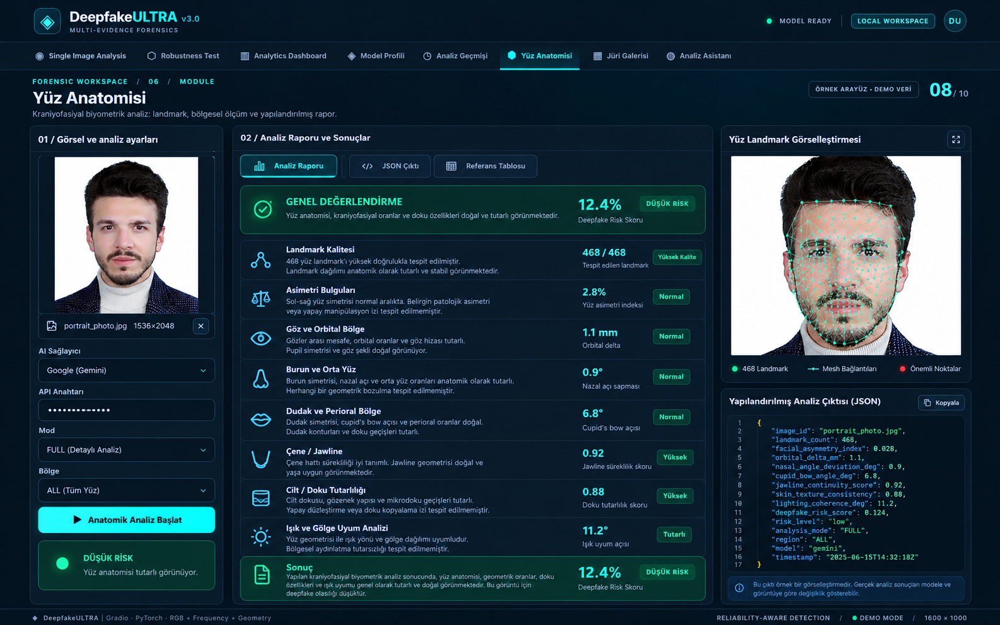
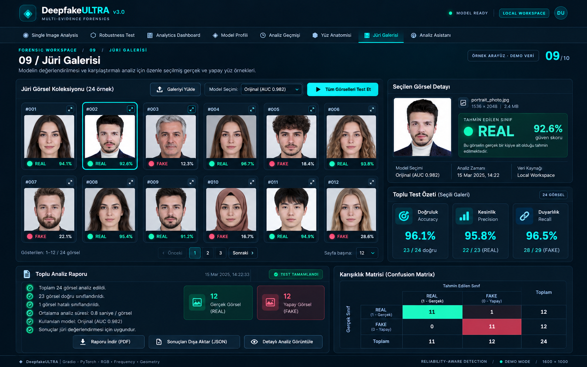
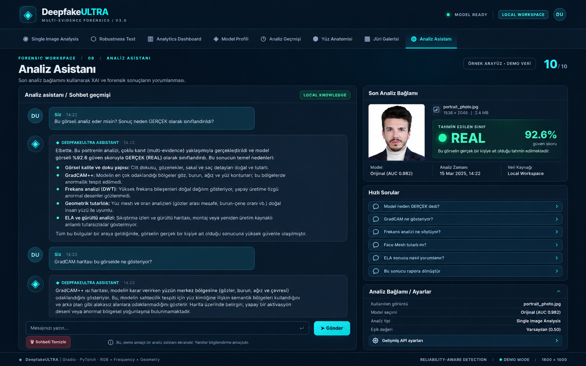

<div align="center">

# DeepfakeULTRA

### Reliability-Aware Multi-Evidence Deepfake Forensics


[](https://github.com/seydivakkas/DeepfakeULTRA/actions/workflows/ci.yml)


**A forensic deepfake detection system that fuses spatial appearance, frequency-domain evidence and facial geometry, then evaluates the model beyond its training distribution.**

**0.9820 internal ROC-AUC** · **0.7405 mean external ROC-AUC** · **5 external datasets** · **artifact-backed evaluation**

`Deepfake Detection` · `Computer Vision` · `XAI` · `Domain Generalization` · `Frequency Analysis` · `Transformers`

</div>

---

## Arayüz Galerisi — 10 Ekran

**Bu görseller ile proje arasında görsel farklılıklar olabilir.**

> Görseller proje tanıtımı için hazırlanmış örnek tasarımlardır. Gösterilen sınıflandırma sonuçları, güven skorları, eğitim ve benchmark bilgileri gerçek model çalıştırma çıktısı değildir. Doğrulanmış metrikler için `evaluation/` dosyalarına bakın.

Güncel arayüzde **8 ana sekme** bulunur. Aşağıdaki 10 ekran, bu sekmelerle birlikte XAI ayrıntılarını ve Domain Fine-Tune görünümünü kapsar.

| Sekme | Görseller |
|---|---|
| Single Image Analysis | 01 — Tek Görsel; 02 — XAI / Forensik detayları |
| Robustness Test | 03 — Dayanıklılık testleri |
| Analytics Dashboard | 04 — Analiz istatistikleri |
| Model Profili | 05 — Model performansı; 06 — Domain Fine-Tune |
| Analiz Geçmişi | 07 — Analiz geçmişi |
| Yüz Anatomisi | 08 — Kraniyofasiyal analiz |
| Jüri Galerisi | 09 — Jüri demosu |
| Analiz Asistanı | 10 — Analiz asistanı |


### 01 — Single Image Analysis



### 02 — XAI ve Forensik Kanıtlar



### 03 — Robustness Test



### 04 — Analytics Dashboard



### 05 — Model Profili



### 06 — Domain Fine-Tune



### 07 — Analiz Geçmişi



### 08 — Yüz Anatomisi



### 09 — Jüri Galerisi



### 10 — Analiz Asistanı



---

## Research question

Deepfake detectors often look strong on an internal validation split and then degrade sharply when the manipulation method, compression pipeline or source domain changes.

DeepfakeULTRA is built around a stricter question:

> **Can multiple forensic evidence streams improve detection while making failure modes, domain shift and model uncertainty inspectable?**

The project therefore treats cross-dataset evaluation and failure analysis as first-class engineering requirements rather than optional benchmark additions.

---

## Minimum reproducible run

```bash
git clone https://github.com/seydivakkas/DeepfakeULTRA.git
cd DeepfakeULTRA
python -m venv .venv
# activate .venv for your shell
pip install -r requirements.txt
python main.py --test-random
python app.py
```

Model weights and large datasets are intentionally not assumed to be present in a fresh clone. Full model-backed inference requires the documented model artifacts; the smoke path above validates the software surface first.

---

## Multi-evidence architecture

```text
Input Face
   ├── RGB Evidence ────────────────┐
   │   MobileNetV3                  │
   │                                │
   ├── Frequency Evidence ──────────┤
   │   DWT + DCT + Phase            │
   │   MobileNetV3                  ├── Cross-Branch Transformer
   │                                │          ↓
   └── Facial Geometry ─────────────┤      Classifier
       468 landmarks + MLP          │          ↓
                                    ┘   REAL / FAKE / UNCERTAIN
```

The frequency branch combines multiple wavelet families, DCT bands and phase information; the geometry branch adds structural facial evidence instead of relying only on RGB texture cues.

---

## Artifact-backed evaluation snapshot

The values below are taken from the machine-readable files currently committed under `evaluation/`.

| Evaluation | ROC-AUC |
|---|---:|
| Internal evaluation | **0.9820** |
| Deepfake20K | **0.9617** |
| DFDC | **0.8057** |
| DeepfakeFace | **0.7614** |
| Celeb-DF v2 | **0.6670** |
| FaceForensics++ | **0.5068** |
| External mean | **0.7405** |

The FaceForensics++ result is intentionally visible: the current repository artifacts show a near-random failure on this domain. Historical experiment values may appear in legacy technical documentation; for the current portfolio summary, machine-readable evaluation artifacts are authoritative.

### Evidence

- [Evidence index](docs/evidence/README.md)
- [Internal metrics](evaluation/metrics.json)
- [External evaluation folders](evaluation/external/)
- [Known limitations](KNOWN_LIMITATIONS.md)

---

## Reliability & forensic tooling

| Capability | Purpose |
|---|---|
| Domain augmentation | Reduce dependence on source-specific JPEG, resolution and color artifacts |
| Test-time augmentation | Check prediction stability under controlled transformations |
| Branch knockout | Measure contribution of RGB, frequency and geometry evidence |
| Adversarial tests | FGSM / PGD / CW stress testing |
| XAI | GradCAM++, EigenCAM, FastCAM and Guided LIME |
| Forensic analysis | ELA and noise-oriented supporting evidence |
| Calibration | Threshold and confidence analysis for non-binary decision handling |
| Error analysis | Make failed domains and manipulation families explicit |

---

## Domain-generalization strategy

```text
Internal Model
    ↓
Domain Augmentation
  JPEG · Resize · Noise · Gamma · Color Shift
    ↓
Curriculum Fine-Tuning
  Frozen → Unfrozen
    ↓
Internal Validation
        +
External Benchmark Suite
    ↓
Evidence-Aware Model Selection
```

Model selection is intended to consider both familiar validation performance and external-domain behavior, reducing the incentive to optimize only for the training distribution.

---

## Product surfaces

- Single-image forensic analysis
- Robustness testing
- Analytics dashboard
- Model evaluation / profiling
- Persistent analysis history
- Craniofacial analysis module
- LLM-assisted result interpretation
- FastAPI inference layer
- Gradio interface

---

## Technology stack

**Machine Learning**  
`PyTorch` · `MobileNetV3` · `Transformer Encoder` · `Mixed Precision` · `CUDA`

**Forensics & Vision**  
`OpenCV` · `MediaPipe` · `DWT` · `DCT` · `Phase Spectrum` · `ELA`

**Explainability & Evaluation**  
`GradCAM++` · `EigenCAM` · `LIME` · `ROC-AUC` · `Calibration` · `Cross-Dataset Benchmarking`

**Application**  
`Gradio` · `FastAPI` · `SQLite` · `Docker`

---

## Engineering principles

1. **External evaluation before generalization claims**
2. **Failure disclosure before benchmark marketing**
3. **Multiple evidence streams before single-cue dependence**
4. **Calibration / uncertainty before forced confidence**
5. **Explainability as an inspection tool, not proof of correctness**
6. **Reproducible evidence before architectural novelty claims**

---

## Research & documentation

- [Architecture index](docs/architecture/README.md)
- [Evidence index](docs/evidence/README.md)
- [Known limitations](KNOWN_LIMITATIONS.md)
- [Citation metadata](CITATION.cff)
- [Full technical documentation](docs/README_FULL.md)

The repository is source-available under the terms in `LICENSE`; it is **not MIT-licensed**.

---

## Lisans ve Kullanım Çerçevesi — Tüm Hakları Saklıdır

**DeepfakeULTRA açık kaynak (open source) bir proje değildir.** Kaynak kodun GitHub'da erişilebilir olması; kodu indirme, çalıştırma, değiştirme, çoğaltma, yeniden yayımlama veya başka bir ürüne entegre etme izni verildiği anlamına gelmez. Proje, **yalnızca görüntüleme ve kişisel öğrenim amacıyla incelemeye** açılmıştır. Geçerli hükümler için [LICENSE](LICENSE) dosyasını okuyun.

### İzin verilen inceleme kapsamı

- Kodun ve mimari açıklamaların **GitHub üzerinde görüntülenmesi ve okunması**.
- Kaynak kodu **kopyalamadan**, kişisel öğrenim amacıyla incelenmesi.
- Mimari yaklaşımın ve kamuya açık bulguların kaynak gösterilerek akademik düzeyde **tartışılması**; bu, yazılımı kullanma veya çoğaltma izni vermez.

### Kullanım ve yeniden dağıtım sınırları

| İşlem veya kullanım senaryosu | Mevcut LICENSE kapsamında |
|---|---|
| GitHub üzerinden kodu okumak ve kişisel öğrenim için incelemek | **İzinli** |
| Ticari ürün, ücretli/ücretsiz servis veya SaaS olarak çalıştırmak | **Yazılı izin olmadan yasak** |
| Şirket içinde, müşteri işinde veya kurumsal prototipte kullanmak | **Yazılı izin olmadan yasak** |
| Üniversite bitirme projesinde, tezde veya TÜBİTAK araştırma prototipinde kodu çalıştırmak ya da entegre etmek | **Yazılı izin olmadan yasak** |
| Kaynak kodunu kopyalamak, çoğaltmak veya parça/parça başka projeye taşımak | **Yazılı izin olmadan yasak** |
| Kodu değiştirmek, türev sürüm geliştirmek veya değişiklikleri yayımlamak | **Yazılı izin olmadan yasak** |
| Kodu yeniden dağıtmak, yayımlamak, satmak, devretmek veya alt lisanslamak | **Yazılı izin olmadan yasak** |
| Başka bir açık kaynak ya da kapalı kaynak ürüne kodu entegre etmek | **Yazılı izin olmadan yasak** |
| Yeniden kullanım/dağıtım amacıyla fork oluşturmak | **LICENSE tarafından ayrıca yetkilendirilmemiştir; yazılı izin gerekir** |
| Tersine mühendislik yapmak | **LICENSE kapsamında yasak** |

**Ticari ve ticari olmayan ayrımı:** Mevcut lisans her iki tür projede de kullanımı sınırlar. Yazılımın ücretsiz sunulması, akademik amaç taşıması veya yalnızca şirket içinde çalıştırılması kendiliğinden izin sağlamaz.

**Araştırma ve eğitim ayrımı:** Proje kodunu okuyarak öğrenmek ile kodu indirip çalıştırarak deney yapmak farklı işlemlerdir. Kaynak kodu çalıştıran, yeniden kullanan veya uyarlayan bir akademik çalışma için de yazarın açık yazılı izni gereklidir. Genel fikirlerin incelenmesi, korunan kodun veya varlıkların kopyalanması için izin yerine geçmez.

**Kod örnekleri ve kurulum komutları:** Bu README'deki teknik çalıştırma komutları, yazarın kendi geliştirme ve yetkilendirilmiş doğrulama süreçlerini açıklamak içindir; ziyaretçilere ayrıca çalıştırma, kopyalama veya dağıtma lisansı vermez.

### Yazılı izin ve lisans talepleri

Ticari lisanslama, akademik deney, kurumsal kullanım, yeniden dağıtım, entegrasyon veya diğer özel izin talepleri için proje sahibiyle GitHub üzerinden iletişime geçin: **[@seydivakkas](https://github.com/seydivakkas)**.

> **Temel kural:** Yazarın açık yazılı izni olmaksızın, [LICENSE](LICENSE) dosyasında tanımlanan görüntüleme ve kişisel öğrenme amaçlı inceleme kapsamının ötesinde bir kullanım hakkı verilmez.

Bu bölüm mevcut lisansın açıklayıcı özetidir; **yeni bir lisans veya ek kullanım izni oluşturmaz**. Lisans metni ve uygulanabilir hukuk esas alınır. Bu açıklamalar hukuki danışmanlık değildir.

---


<div align="center">

**Detect · explain · stress-test · disclose failure modes**

[GitHub Profile](https://github.com/seydivakkas) · [Evidence](docs/evidence/README.md) · [Limitations](KNOWN_LIMITATIONS.md)

</div>
